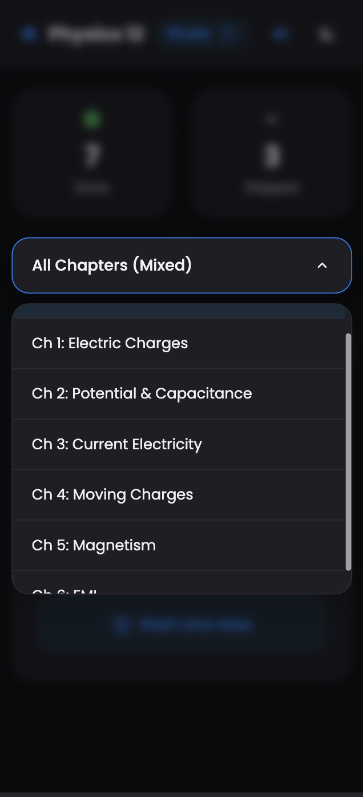
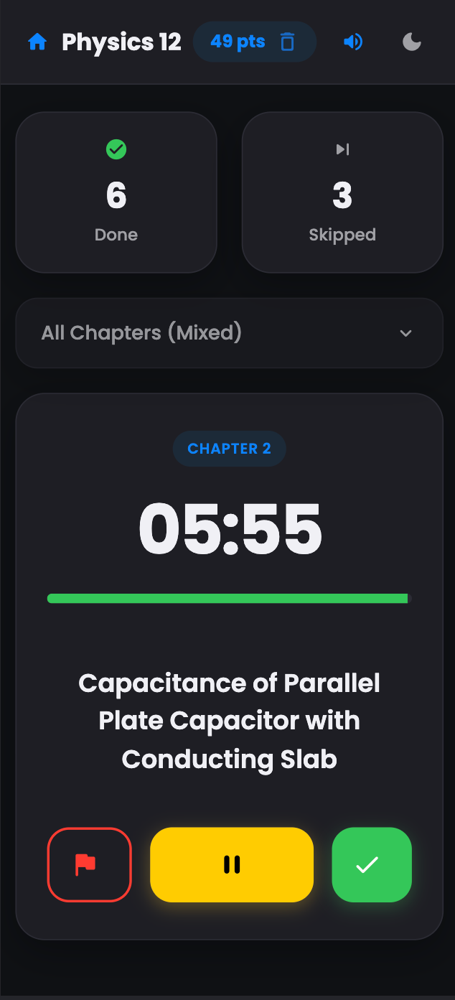
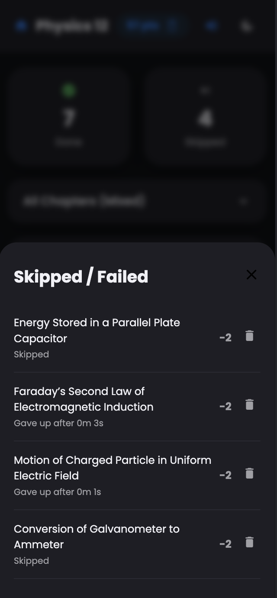

<div align="center">
  
# Physics Derivation Trainer


### Built for CBSE Class 12 Physics (2026)

Electrostatics through EMI, practiced like a game.


*Last updated: March 2026*

---

                                        </div>

---

## Modes

### Random Roll
-  Pick a chapter, or leave it on "All Chapters (Mixed)"
-  The app picks a derivation and starts a countdown timer sized to it
-  Finish, skip, or let the timer run out — each has a different score effect (below)

### Line-wise Checklist
-  Browse every derivation, sorted by chapter
-  Tap to check off ones you've mastered
-  Unchecking removes it again, points included

## Scoring

| Outcome | Points |
|---|---|
| Finish before time runs out | **+5**, plus **+1 per full minute left on the clock** |
| Skip a derivation | **−2** |
| Timer hits zero | **−1** |
| Check off an item in the checklist | **+5** |

## Other details

-  Light / dark mode, follows your system setting
-  Click, tick, success, and fail sounds — generated live with the Web Audio API, no audio files
-  Score, history, and checklist are saved to `localStorage` — refreshing or closing the tab doesn't reset you
-  Responsive layout, built for practicing on a phone

## Running it

1. Download `derivations.html`
2. Open it in any browser

#### That's it.

## Content

Six chapters, pre-loaded:

1. Electric Charges & Fields
2. Electrostatic Potential & Capacitance
3. Current Electricity
4. Moving Charges & Magnetism
5. Magnetism & Matter
6. Electromagnetic Induction

To add or edit derivations, open the `derivations` array near the top of the `<script>` block. Each entry looks like:

```js
{ id: 1, text: "Coulomb's Law", ch: 1, time: 5, prob: 1.0 }
```

- `time` — minutes on the countdown
- `prob` — relative weight in Random Roll (raise it to make a topic come up more often; all are currently equal)

## License

MIT. Fork it, change it, use it to study.

---

<div align="center">

**Questions, bugs, or feature requests? Get in touch.**

*peeyushdadwal@gmail.com*
</div>
